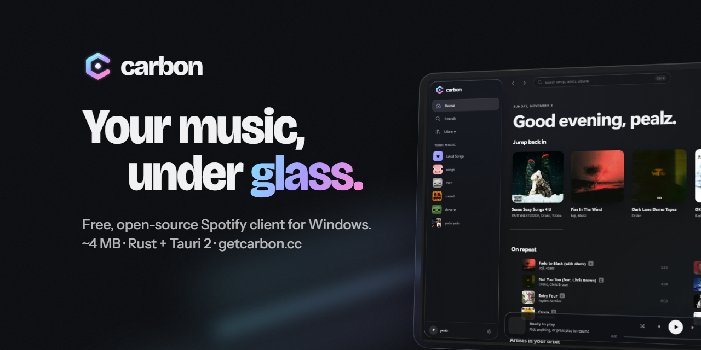
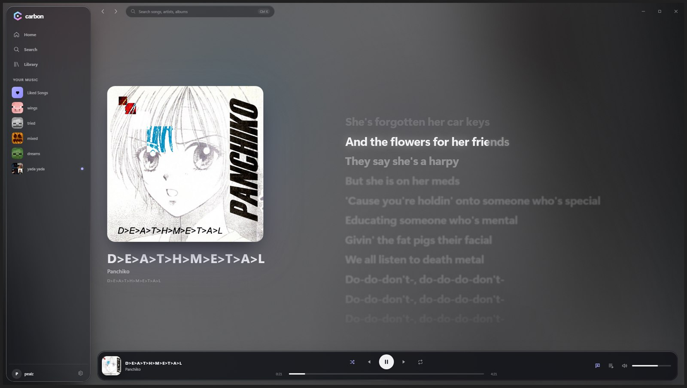
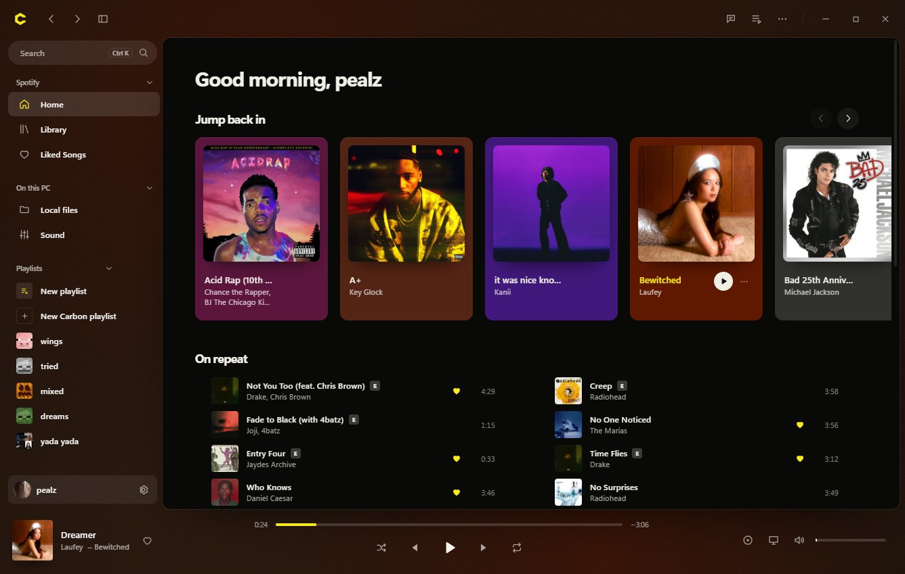

<div align="center">



<br>

**A fast, beautiful Spotify client for Windows, built in Rust.**

[](https://github.com/pealz1/carbon/releases/latest)
[](https://github.com/pealz1/carbon/releases)
[](https://github.com/pealz1/carbon/actions/workflows/ci.yml)
[](LICENSE)
[](https://github.com/pealz1/carbon/stargazers)

[**Download**](https://github.com/pealz1/carbon/releases/latest) · [Website](https://getcarbon.cc) · [Setup guide](https://getcarbon.cc/setup) · [Report a bug](https://github.com/pealz1/carbon/issues/new/choose)

</div>

---



## Why Carbon

Carbon is a native Rust app that plays your music itself, looks like it belongs on a modern desktop, and stays out of your way.

- **Liquid glass interface.** Frosted, refracting panels over light pulled from whatever's playing.
- **Liquid lyrics.** Time-synced lyrics that fill word by word as they're sung. Click any line to jump there.
- **Plays music itself.** Spotify's official Web Playback SDK, right inside Carbon. No Spotify app needed.
- **Feels native.** Media keys, the Windows media overlay, a tray icon with controls, launch at startup, keep playing when closed.
- **Discord status.** Shows what you're listening to, with album art and a live progress bar.
- **Last.fm scrobbling.** Built in, following Last.fm's scrobbling rules.
- **Private by design.** No ads, no analytics, no tracking. Your Spotify sign-in lives in Windows Credential Manager.
- **Your playlists, your way.** Create and edit playlists, change covers, like songs, and organize with folders, tags and pins.
- **Your own files too.** A built-in audio engine plays local music gapless, with a 10-band EQ, loudness levelling and crossfade. Carbon playlists mix local files with Spotify songs.
- **Cinema mode.** Full-screen artwork and lyrics, with controls that get out of the way.
- **Phone remote and SDK.** Pair your phone over Wi-Fi with a QR code, or build on Carbon with [`@getcarbon/sdk`](packages/carbon-sdk).
- **Updates itself.** Signed updates, verified before they install.



## Get started

1. **Download** the installer from the [latest release](https://github.com/pealz1/carbon/releases/latest) and run it.
2. **Create your Spotify app.** Spotify lets each developer app serve only five listeners, so Carbon runs on your own free one. It takes about two minutes: [step-by-step guide](https://getcarbon.cc/setup).
3. **Paste your Client ID** into Carbon, sign in with Spotify, and press play.

You'll need Windows 10 or 11 and **Spotify Premium** (Spotify only allows Premium accounts to play through apps like Carbon).

> Windows may show a SmartScreen warning the first time, because Carbon isn't signed with a paid code-signing certificate yet. Choose **More info → Run anyway**.

## Support Carbon

Everything in Carbon is free, for everyone, and it stays that way. If you'd like to help keep it maintained, see [getcarbon.cc/#support](https://getcarbon.cc/#support). Donations are voluntary and don't unlock anything in the app.

## Building from source

```bash
git clone https://github.com/pealz1/carbon.git
cd carbon
npm install
npm run tauri dev
```

You'll need Node.js 22+, stable Rust and your own Spotify Client ID. [CONTRIBUTING.md](CONTRIBUTING.md) has the full setup, project layout and checks.

## Built with

[Tauri 2](https://tauri.app) and Rust for the core · [Svelte 5](https://svelte.dev) for the interface · Spotify's [Web Playback SDK](https://developer.spotify.com/documentation/web-playback-sdk) · lyrics from [LRCLIB](https://lrclib.net) · [souvlaki](https://github.com/Sinono3/souvlaki) for Windows media controls

## Contributing

Issues and pull requests are welcome. Start with [CONTRIBUTING.md](CONTRIBUTING.md), and please report security problems privately ([SECURITY.md](SECURITY.md)).

<a href="https://star-history.com/#pealz1/carbon&Date">
  
</a>

## License

[MIT](LICENSE). Carbon isn't affiliated with, endorsed by, or sponsored by Spotify. Spotify is a trademark of Spotify AB.
